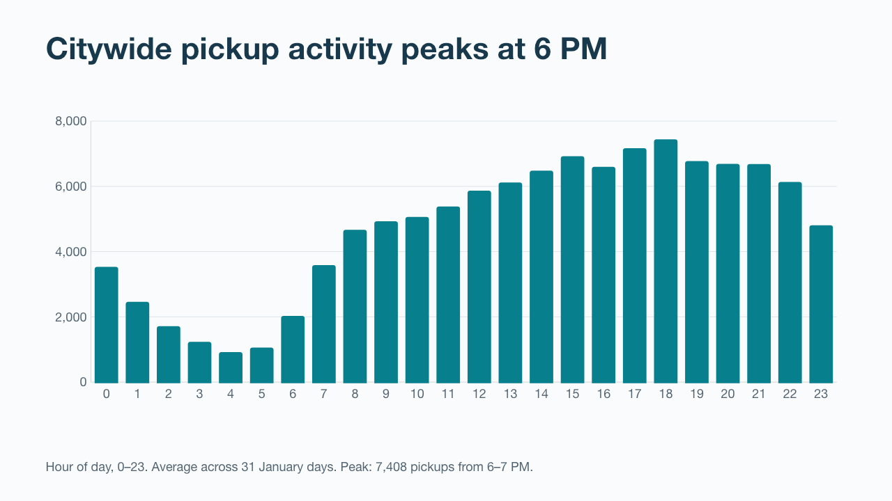

# NYC Taxi Business Intelligence Platform

## Project Overview

This project analyzes NYC Yellow Taxi trip data to identify revenue trends, high-demand locations, operational patterns, and opportunities for improved driver allocation.

The project uses a SQL-first business intelligence workflow. DuckDB queries NYC Taxi and Limousine Commission Parquet files, transforms raw records into analytical models, and produces datasets for a Tableau dashboard.

## Tableau dashboard

[Download the packaged workbook](tableau/NYC%20Taxi%20Demand.twbx) and open it in Tableau. The package contains six summary datasets; no local DuckDB connection or raw trip file is needed to view it. On GitHub, download the file rather than trying to preview it in the browser.

The workbook contains three ordered presentation dashboards: **01 Demand overview**, **02 Coverage and airport decisions**, and **03 Pilot and measurement**. It includes four charts, a priority pickup-window table, and an airport comparison table backed by six embedded extracts. The editable source is [NYC Taxi Demand.twb](tableau/NYC%20Taxi%20Demand.twb).

## Stakeholder presentation

**Business question:** Where and when should a fleet test changes to driver coverage to improve net earnings per working hour without worsening passenger service?

- [Eight-slide presentation with speaker notes](presentation/NYC_Taxi_Stakeholder_Presentation.pptx)
- [Presentation guide and pilot measurement plan](docs/presentation_guide.md)
- [Findings, recommendations and limitations](docs/stakeholder_story.md)
- [Metric definitions](docs/metric_definitions.md)
- [Machine-readable analysis evidence and check results](docs/analysis_evidence.json)

The presentation is a decision proposal, not a claim of achieved business growth. It connects observed pickup patterns to a controlled coverage pilot and identifies the dispatch, waiting-time and cost data needed to measure success.



**Verification status:** All 66 SQL checks passed. Embedded extract row counts, relative file connections and ZIP integrity were checked. The eight presentation slides were rendered and visually reviewed and passed package/layout checks. Tableau's application log confirms successful rendering of all six worksheets and the first two dashboard pages after the extract-definition repair. The third, text-only pilot page and final dashboard appearance still require a human visual review; render logs alone do not verify layout. This repository does not include a published Tableau Public link.

### January 2026 findings

- 3,517,775 eligible trips from 3,724,882 January pickup records.
- The top 15 pickup zones account for 45.8% of eligible trips.
- Citywide pickups peak at 6 PM, averaging approximately 7,408 trips in that hour per day.
- JFK pickups average $79.27 in recorded payments per trip, versus $29.68 overall. Higher payments do not establish higher profit.

These findings support a pilot of zone-specific shift coverage, not a claim of achieved revenue growth. See the [stakeholder story](docs/stakeholder_story.md) for recommendations and limitations.

Heatmap averages include only days with pickups in the corresponding zone/hour. They are not averages across every calendar day. The data describe completed, eligible recorded trips—not unmet demand. Passenger counts are missing on 28.3% of eligible trips.

### Refresh the package

With the project dependencies and January 2026 source files available:

```sh
.venv/bin/python scripts/package_tableau.py
```

Install `requirements.txt` first. This rebuilds the SQL views in an isolated in-memory database, runs the quality checks, refreshes six dashboard datasets and their embedded Hyper extracts, and packages the workbook. It does not need access to the potentially locked `database/taxi.duckdb` file. Tableau Hyper requires permission to start its local process. Dashboard and presentation narrative text is a fixed January 2026 snapshot; review it when changing the reporting period or eligibility rules. The PowerPoint is an editable presentation snapshot, not an automatically refreshed report.

## Business Scenario

A transportation company has asked its data analyst to determine:

- Where taxi demand is highest
- Which locations and routes generate the most revenue
- How demand changes by time and day
- Which trips may contain data-quality problems
- Where additional driver availability may be needed

## Technology

- SQL
- DuckDB
- Python
- Git and GitHub
- NYC TLC Parquet data
- Tableau Public

## Running the analysis and validation

Run commands from the project root. The SQL files in `sql/05_analysis/` now
create DuckDB views and then select from them, so they both register the
reporting objects and show results. Run the files in this order:

1. `sql/02_staging/01_clean_trips.sql`
2. `sql/03_models/01_enriched_trips.sql`
3. All seven files in `sql/05_analysis/`, in numeric order
4. The corresponding files in `sql/04_quality/`

For example:

```sh
.venv/bin/python scripts/run_sql.py sql/05_analysis/01_daily_demand_revenue.sql
.venv/bin/python scripts/run_sql.py sql/04_quality/03_reconcile_daily_demand.sql
```

After editing an analysis SQL file, rerun that file to replace its saved view
definition before running reconciliation. The zone-hour and route analysis files
also create unrounded intermediate views used to validate their displayed
averages. Reconciliation reads the same analysis views used for reporting;
expected totals still come independently from `enriched_yellow_trips`.
